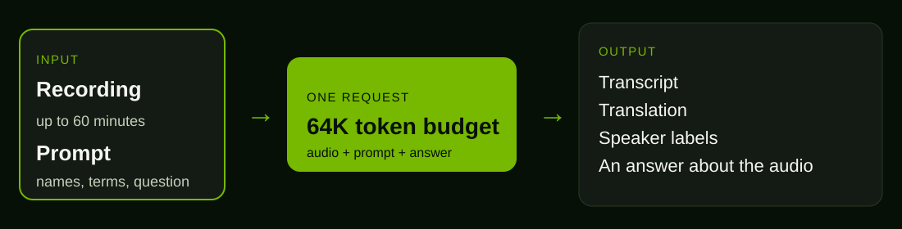

# One recording. A transcript you can use.

**4 min read** · NVIDIA Nemotron 3.5 Transcribe

---

This page walks the model in order. The weights are not in the repository. This Mac has no NVIDIA GPU, so the console plays a local clip and shows the shape of a result.

## What the model is

Nemotron 3.5 Transcribe is an open, promptable speech model. You give it a recording and a short instruction. It writes the text.

It is not the small streaming model. Nemotron 3.5 ASR is about 600 million parameters, and it is built for live audio. Transcribe is a mixture-of-experts model: about 30 billion parameters in total, with about 4 billion active on a given step. A mixture of experts keeps most of the network quiet and uses a small slice for each step. That is how a 30-billion-parameter model can still be practical.

It is built for a recording you already have. A call. A meeting. A file up to 60 minutes.

## One request, one budget

Audio, your prompt, and the answer share 64,000 tokens. A token is one slice of that budget. A long file plus a long prompt leaves less room for the answer. That is the limit to plan around.

The same model, the same audio, a different instruction:

1. **Transcribe.** Write down what was said. About 40 languages, and it can switch language in the middle of a sentence.
2. **Translate.** For 31 of those languages, ask for English, or ask for that language from English.
3. **Label speakers.** In 13 languages it can mark up to 8 speakers. The 13 are Arabic, Mandarin, English, French, German, Hindi, Italian, Japanese, Korean, Portuguese, Russian, Spanish, and Thai.
4. **Use context.** Hand it the names and the terms you care about, so a name is spelled the way your list spells it.
5. **Ask about the audio.** The recording can be something you question, not only a file you transcribe.

All of that is self-hosted. Your GPUs, from a local machine up to the data centre.

## How fast it is

RTFx means real-time factor. A figure of 100x means one second of GPU work clears about 100 seconds of audio. These numbers are NVIDIA's figures. This Mac has no NVIDIA GPU, so I have not measured them.

| Machine | RTFx | 100 hours of audio | How to run it |
| --- | ---: | --- | --- |
| Jetson AGX Thor | 106x | 57 min | NeMo-Speech.cpp, JetPack |
| RTX Spark (N1X) | 274x | 22 min | NeMo-Speech.cpp, Windows 11 ARM64 |
| DGX Spark | 370x | 16 min | NeMo-Speech.cpp or NIM |
| RTX 5090 | 587x | 10 min | NIM |
| H100 / H200 | 1,340x | 4.5 min | NIM |
| RTX PRO 6000 Blackwell | 2,325x | 2.6 min | NIM |
| B200 / GB200 | 3,064x | 2 min | NIM |

## What to test

Four checks are worth running once the weights are on a GPU.

1. A real language switch, in any of the 40 languages.
2. A domain word, once with the term list and once without it.
3. Speaker labels on a multi-speaker clip, in one of the 13 languages.
4. Throughput, with the full test setup written down.

The data recipe behind the model is called Granary-v2. It is an open labelling pipeline, with open labels across 48 languages, so a later fine-tune has something to train on: transcripts, translations, domain terms, long recordings, and language labels.

## This page

The showcase plays an 11-second clip I made on the Mac: an agent, a customer, and a supervisor. The tabs are the jobs one request can do. Words, speakers, timing, a language line, the JSON a caller would parse, and the speaker changes.

The phrase times are marked by hand, so the playhead has something honest to follow. They are not model output. The 30-billion-parameter weights are not on this machine, and they are not in git.

https://github.com/cobusgreyling/nemotron-3.5-transcribe
