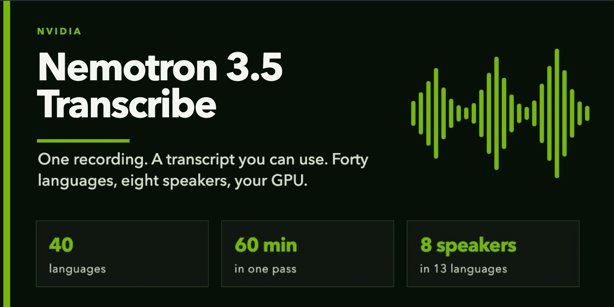

<p align="center">
  
</p>

# Nemotron 3.5 Transcribe — Showcase

This Mac has no NVIDIA GPU. This repo is the walkthrough: what the model is, what one request returns, and a local console that shows the shape of a result. The weights are **not** in git.

**Read the post → [`BLOG.md`](BLOG.md)**

## 30-second start

```bash
git clone https://github.com/cobusgreyling/nemotron-3.5-transcribe.git
cd nemotron-3.5-transcribe
./run.sh
# → http://127.0.0.1:7877
```

No CUDA. You get an 11-second clip and seven tabs: signal, words, languages, speakers, timing, JSON, events.

## What the model is

| | |
| --- | --- |
| Kind | Open, promptable transcription of a recording |
| Size | ~30B total, ~4B active |
| Languages | 40, including a switch mid-sentence |
| Translation | 31 languages, to and from English |
| Speakers | Up to 8, in 13 languages |
| Length | Up to 60 minutes in one pass |
| Budget | 64K tokens, shared by audio, prompt, and answer |
| Where it runs | Your GPUs. Edge to data centre |

Nemotron 3.5 ASR is a different model. That one is the 600M streaming recogniser. This one is for a file you already have.

## When you have the weights

1. Keep the checkpoint out of git.
2. Test a language switch, a term list, speaker labels, and throughput.

## Layout

```
index.html          console
app.js              tabs, playhead, language chips
assets/header.jpg   banner
assets/flow.svg     one request
assets/throughput.svg
assets/demo.wav     local three-voice clip
BLOG.md             the post
```

## Licence

Lab code: Apache-2.0. The NVIDIA weights are not included.
